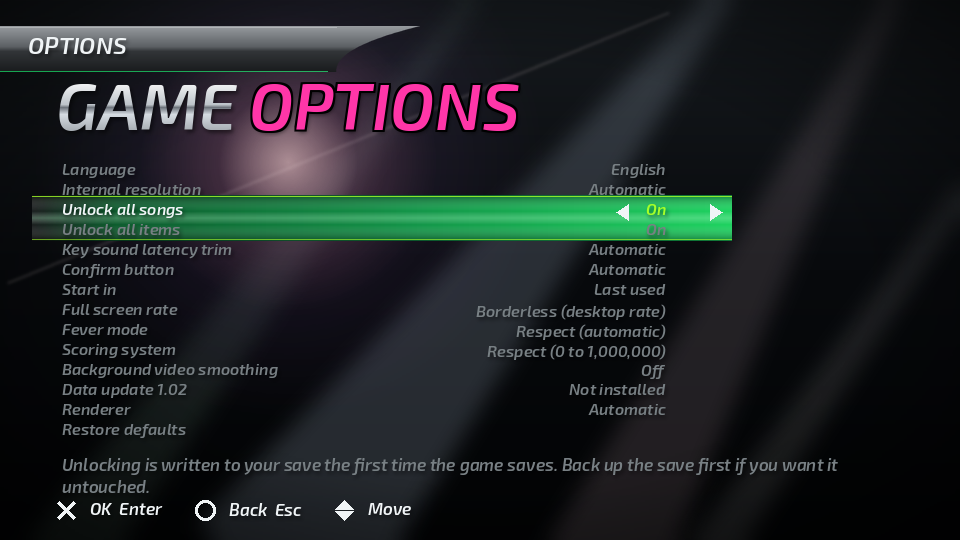

# EmotionalSense-P3

[](https://github.com/burnermanx/emotionalsense-p3/actions/workflows/ci.yml)

> **DJMAX Portable 3** (PSP, 2010 -- `ULKS46236`) statically recompiled to a native
> game for Linux and Windows (x86-64 and arm64) that a small launcher builds on
> your own computer from your own disc. Built on
> [psprecomp](https://github.com/sp00nznet/psprecomp).

> [!CAUTION]
> **No game data lives in this repository or in any download.** The ISO,
> everything extracted or decrypted from it, the C generated from the game's code
> and the binaries built from it are derived from *your own* disc. They stay on
> your machine and must never be committed or redistributed -- that includes the
> game you prepare.

## What you need

- Your own **ISO of the Korean version of DJMAX Portable 3 (`ULKS46236`)**. Other
  regions and other titles are refused.
- Optionally, the Korean **1.02 data update** (the folder that holds
  `PSP/GAME/ULKS46236/DATA.TPA`); see [`docs/update-1.02.md`](docs/update-1.02.md).
  The update's own patcher is never run.
- A computer with a Vulkan graphics driver (the software renderer works too, but
  slowly). Nothing else: the compiler travels inside the launcher, so no CMake,
  git, compiler, `-dev` packages or network are needed. The game window and the
  launcher are keyboard or gamepad driven.

## Download

Get the package for your system from the
[releases page](https://github.com/burnermanx/emotionalsense-p3/releases) and
check it against `SHA256SUMS`:

| System | Package |
|---|---|
| Windows x86-64 | `EmotionalSense-P3-0.1.0-windows-x86_64.zip` |
| Windows arm64 | `EmotionalSense-P3-0.1.0-windows-arm64.zip` |
| Linux x86-64 | `EmotionalSense-P3-0.1.0-linux-x86_64.AppImage` or `...-linux-x86_64.tar.gz` |
| Linux arm64 (aarch64) | `EmotionalSense-P3-0.1.0-linux-aarch64.AppImage` or `...-linux-aarch64.tar.gz` |

A release also carries the source tarball and the source of the third-party GPL
tool the launcher runs (see [`THIRD_PARTY_NOTICES.md`](THIRD_PARTY_NOTICES.md)).

The AppImage and the `tar.gz` hold the same launcher. Windows: unzip anywhere you
can write to (not `Program Files`) and run `EmotionalSense-P3.exe`. Linux: make
the AppImage executable and run it, or unpack the `tar.gz` and run
`EmotionalSense-P3/EmotionalSense-P3`.

## First use

1. Start the launcher and choose your ISO. It extracts the disc, decrypts
   `EBOOT.BIN`, recompiles the game to C and compiles it with the compiler it
   carries. This happens once (about half a minute on a modern 16-thread
   machine) and again when the launcher or the ISO changes.
2. Press **Play**. The language of the launcher follows the system (Portuguese
   of Brazil, English, Spanish, Japanese, Korean); the Spanish, Japanese and
   Korean texts are machine-written and need review by a native speaker.
3. The first start of a new data folder asks for a player name, like the PSP game.



## Where your data lives (portable)

Everything is kept next to the program, in a folder called
`EmotionalSense-P3-data`:

- Windows: next to `EmotionalSense-P3.exe`;
- AppImage: next to the `.AppImage` file (not inside the image);
- `tar.gz`: next to the launcher binary.

It holds the launcher's settings, the extracted disc, the recompiled game, the
caches, your save (`ms/PSP/SAVEDATA/ULKS46236<>/SD.BIN`; on Windows the folder is
`ULKS46236%3C%3E`), your Respect scores (`es_scores.json`), the 1.02 update, the
logs and the crash reports. Nothing is written to
your home folder, `%APPDATA%`, `%LOCALAPPDATA%`, `~/.cache`, `~/.config` or
`~/.local`. To move the game, move the program and that folder together; to
remove it, delete both.

If the program sits in a folder you cannot write to, the launcher says so and
asks you to move it (it never falls back to your home folder). If it finds data of
an older version in the old places, it offers to **copy** it into the new folder
(nothing is moved or deleted). The launcher's "Back up save" button copies `SD.BIN`
and `es_scores.json` to `save-backups/`.

## Controls

| Keyboard | Controller | PSP |
|---|---|---|
| Arrows | D-pad | D-pad |
| -- | Left stick | Analog |
| Z / X / A / S | A / B / X / Y | cross / circle / square / triangle |
| Q / W | LB, LT / RB, RT | L / R |
| Enter / Backspace | Start / Back | Start / Select |
| Alt+Enter | | borderless full screen <-> window |
| F11 | | full screen at the rate chosen in the launcher <-> window |
| Esc | | on the title screen: quit the game (asks first) |

The PSP game confirms with circle; Western players expect cross. The launcher's
**Confirm button** option is `Automatic` (circle for Japanese and Korean, cross for
every other language), `circle` or `cross`; it only applies to menus, never to the
lanes. Quitting from the title screen returns to the launcher.

## Options

Everything is in the launcher's Options screen and saved automatically.

| Option | What it does |
|---|---|
| Language | launcher and in-game prompts: Automatic, Portuguese (Brazil), English, Spanish, Japanese, Korean |
| Internal resolution | Automatic (the smallest scale that covers the window), 1x to 4x |
| Unlock all songs / items | all charts, DJ icons, crews, gear, notes, gallery, videos and the 4.2T / 6.2T modes. **The unlock is written to your save the first time the game saves**; back up `SD.BIN` first if you want it untouched. See [`docs/unlock-table.md`](docs/unlock-table.md) |
| Key sound latency trim | tunes keysound against music by ear (default: both equal) |
| Confirm button | see Controls |
| Start in | last used, window or borderless full screen (a Steam Deck in game mode starts in full screen) |
| Full screen rate | Borderless (default, desktop rate) or an exclusive 60 / 120 Hz mode for F11 |
| Fever mode | **Respect** (default): the Fever starts by itself when the gauge fills and the lane speed you chose is kept. **Original**: the PSP game untouched ([`docs/fever.md`](docs/fever.md)) |
| Scoring system | **Respect** (default): your judgment percentage out of 1,000,000 (87.8 % reads 878,000; 100 % reads exactly 1,000,000), on the result screen and in the song list. **Original**: the PSP score. Display only: the game keeps writing its own record in both modes ([`docs/score.md`](docs/score.md)) |
| Background video smoothing | blends the 30 fps background video (off by default) |
| Data update 1.02 | installs or removes the optional update |
| Renderer | Automatic, Vulkan or software |

### Custom textures

The game loads PNG files from `EmotionalSense-P3-data/textures/` (a texture pack made by hand, named by the
key the game uses; see [`docs/technical.md`](docs/technical.md)) and shows them in place of the original
art. There is no texture pack in v0.1 and none is provided.

## If the game crashes

The game writes a report to `EmotionalSense-P3-data/crashes/crash-<date>-<time>.txt`
and the launcher then offers to open the folder, copy the report or **open an issue
on GitHub** with a short summary filled in. Nothing is sent automatically: read the
report and attach it yourself. It lists the version, your system and graphics card,
the game options and what the game was doing; it holds no save, no disc content and
no environment variables, and your home folder appears as `~`. A freeze (no frame
for 20 s) writes a report too, and the game keeps running.
[`docs/diagnostics.md`](docs/diagnostics.md) describes the report.

## Common problems

- **"This folder cannot be written to"**: move the program to a folder you can
  write to (Documents, a Games folder), not `Program Files` or a system folder.
- **The launcher says the file is not a PSP image / wrong region**: only the Korean
  version `ULKS46236` is supported.
- **No picture or a very slow game**: the game uses Vulkan; update the graphics
  driver. Choose the Vulkan renderer in the options; software rendering is a
  fallback.
- **Choppy or late sound**: use the "Key sound latency trim" option; see
  [`docs/audio.md`](docs/audio.md).
- **The unlock changed my save**: that is documented above; restore `SD.BIN` from
  `save-backups/`.
- **A "No Memory Stick Duo has been inserted... Failed to load Install Data" message
  on the first run**: expected on a brand-new save. The game then shows its tutorial.
  Data Install is not needed; nothing is wrong.
- Open an issue with the crash report for anything else.

## Command line

For scripts and CI: `EmotionalSense-P3 --iso game.iso --prepare`, `--run`,
`--backup-save`, `--selftest`, `--lang xx`, `--data DIR`,
`--confirm auto|circle|cross`, `--update FOLDER` / `--remove-update`,
`--migrate-legacy`. The game binary has `--version`, `--help`
and the `EMOTIONALSENSE_*` variables listed in
[`docs/diagnostics.md`](docs/diagnostics.md). The launcher is `EmotionalSense-P3`
and the game it starts is `EmotionalSense-P3-game` (`.exe` on Windows).

## Building from source

The released path needs a *kit* (the compiler, SDL2 and FFmpeg for one target) built
by `scripts/make_kit.py`; `scripts/build_launcher.py` packs the launcher around it
and `.github/workflows/release.yml` shows every pinned input for the six targets.
For development on Linux:

```bash
git clone --recursive https://github.com/burnermanx/emotionalsense-p3 && cd emotionalsense-p3
./scripts/install-deps-arch.sh        # or the equivalent packages: cmake, ninja, SDL2, FFmpeg, Vulkan headers
cmake -B build -G Ninja && cmake --build build
python3 launcher/es_dev.py --iso game.iso --data <a data folder of your own>   # whole pipeline, system compiler
python3 -m unittest discover launcher/tests
```

Never point the pipeline at a data folder holding a save you care about while
testing: the routes in `scripts/` finish songs, and the game then writes the save.
Technical notes (how it works, what the fork adds, how correctness is decided,
debugging, building for Windows): [`docs/technical.md`](docs/technical.md); the
version history is [`CHANGELOG.md`](CHANGELOG.md).

## AI assistance

This port is built by a person and AI agents working together, and it says so
because the result is judged on the measurements above, not on how it was
written.

The loop that produced most of it: an agent reads the disassembly, the memory
and the traces and writes a task list with acceptance criteria; another agent
implements a task at a time and verifies it against those criteria; the person
runs the result on real hardware, plays the game and decides whether it is
right. The human owns the goal, the acceptance and every merge.

Concrete cases where the split mattered:

- The "all songs" CWCheat code was being applied at the wrong address and in
  the wrong format, which corrupted the song list and hung the music select.
  The agent found it by reading the unlock test at `0x53144` and the list build
  at `0x56918` (the loop that calls the test is `0x56980..0x569E0`); the person
  reported the hang and played the fixed build.
- The 4.2T mode stayed locked in PLAY MODE SELECT, and the first explanation
  was wrong: the agent read a `u16` at `0x134960` as a mode bitmap, wrote to it,
  and the mode only appeared to unlock because the save had reached the level
  the game asks for. Reading the two lock checks (`0x27C78` and `0x2D780`)
  showed the real rule -- 4.2T is gated on the player level, and 6.2T on an
  ownership bit -- and the fix moved to a wrap on the level query. The lesson
  kept in `docs/unlock-table.md`: a save diff says which bytes differ, not
  which one decides.
- Internal resolution ran at 20 frames per second. The agent found the cost by
  timing each stage (reading 8 MB from a non-cached mapping); the person judged
  the picture.
- Audio drifted out of sync and clicked in long keysounds. The agent measured
  the ring level and the underruns and changed the pacing; the person reported
  the symptom and will be the one to say it is gone.

The prose in `docs/` and in this file is written by agents and edited by the
person who owns the project; the measurements in it come from runs on the
project owner's machine and, where noted, from `wine`.


## Legal

MIT (see `LICENSE`), like psprecomp. `pspdecrypt` (GPL-3.0) is built from a pinned
revision and shipped as a separate program that the launcher executes -- never linked
or vendored; its source is attached to every release (`THIRD_PARTY_NOTICES.md`,
`licenses/`). DJMAX is a trademark of NEOWIZ; this project contains none of its code
or data.
